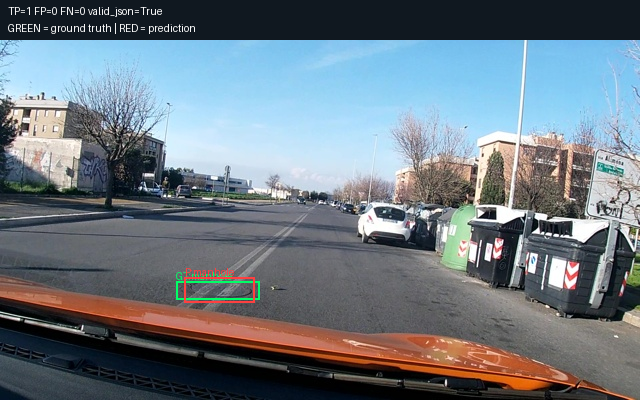
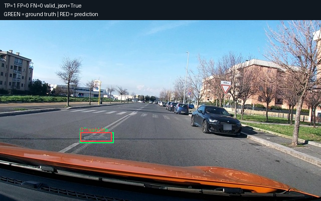
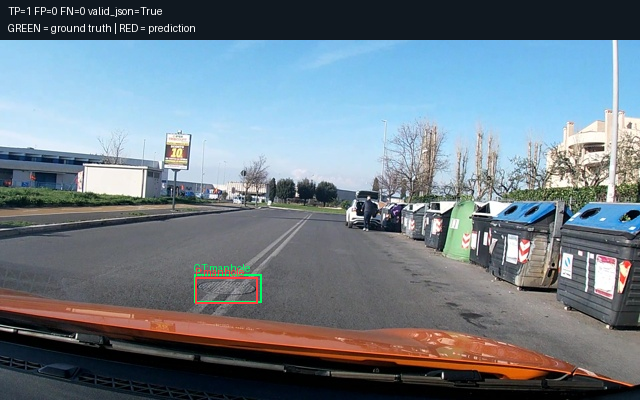
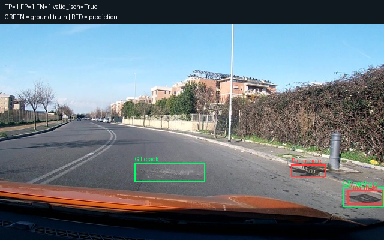
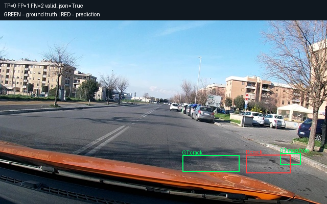
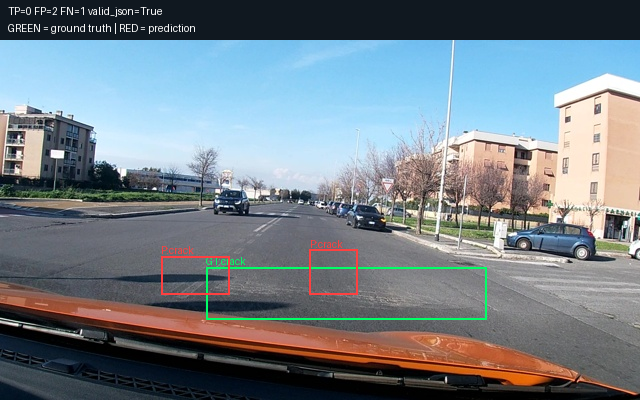

# Prediction examples

Green: ground truth. Red: predictions.

Examples are selected for illustration, not an estimate of accuracy.

## 1. vlcsnap-00202

TP=1 FP=0 FN=0 valid_json=True



Raw output:

```text
[{"label":"manhole","bbox_2d":[289,661,398,728]}]
```

## 2. vlcsnap-00204

TP=1 FP=0 FN=0 valid_json=True



Raw output:

```text
[{"label":"manhole","bbox_2d":[250,622,348,672]}]
```

## 3. vlcsnap-00206

TP=1 FP=0 FN=0 valid_json=True



Raw output:

```text
[{"label":"manhole","bbox_2d":[305,661,402,733]}]
```

## 4. vlcsnap-00200

TP=1 FP=1 FN=1 valid_json=True



Raw output:

```text
[{"label":"manhole","bbox_2d":[759,650,847,708]},{"label":"manhole","bbox_2d":[906,772,997,836]}]
```

## 5. vlcsnap-00201

TP=0 FP=1 FN=2 valid_json=True



Raw output:

```text
[{"label":"crack","bbox_2d":[752,733,889,833]}]
```

## 6. vlcsnap-00203

TP=0 FP=2 FN=1 valid_json=True



Raw output:

```text
[{"label":"crack","bbox_2d":[484,583,559,708]},{"label":"crack","bbox_2d":[252,600,359,708]}]
```
