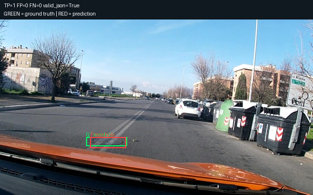
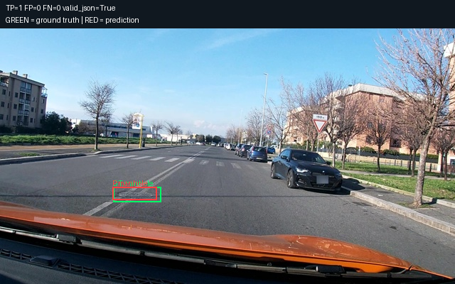
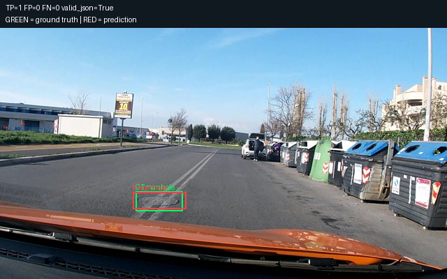
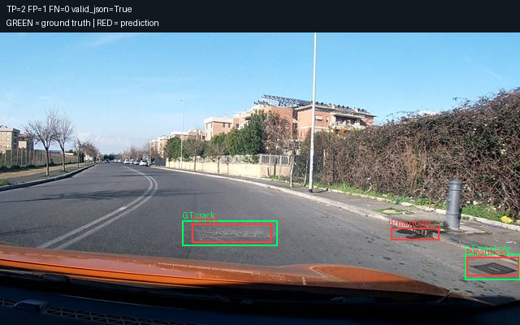
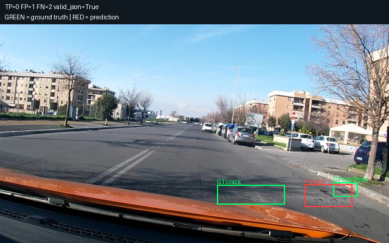
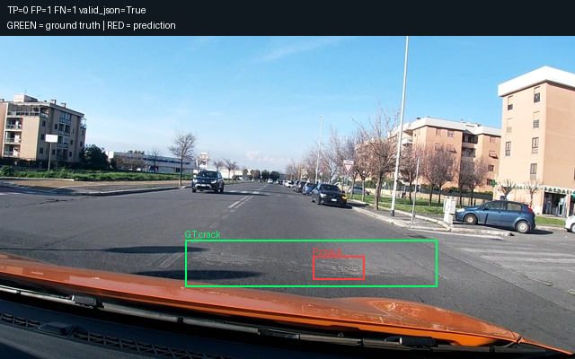

# Prediction examples

Green: ground truth. Red: predictions.

Examples are selected for illustration, not an estimate of accuracy.

## 1. vlcsnap-00202

TP=1 FP=0 FN=0 valid_json=True



Raw output:

```text
[{"label":"manhole","bbox_2d":[289,672,402,733]}]
```

## 2. vlcsnap-00204

TP=1 FP=0 FN=0 valid_json=True



Raw output:

```text
[{"label":"manhole","bbox_2d":[247,622,344,672]}]
```

## 3. vlcsnap-00206

TP=1 FP=0 FN=0 valid_json=True



Raw output:

```text
[{"label":"manhole","bbox_2d":[297,653,416,722]}]
```

## 4. vlcsnap-00200

TP=2 FP=1 FN=0 valid_json=True



Raw output:

```text
[{"label":"crack","bbox_2d":[369,653,523,717]},{"label":"manhole","bbox_2d":[752,667,844,711]},{"label":"manhole","bbox_2d":[897,767,997,833]}]
```

## 5. vlcsnap-00201

TP=0 FP=1 FN=2 valid_json=True



Raw output:

```text
[{"label":"crack","bbox_2d":[784,733,906,836]}]
```

## 6. vlcsnap-00203

TP=0 FP=1 FN=1 valid_json=True



Raw output:

```text
[{"label":"crack","bbox_2d":[544,683,633,753]}]
```
