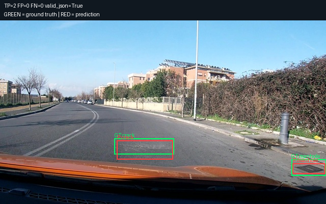
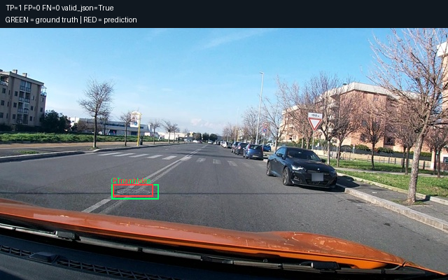
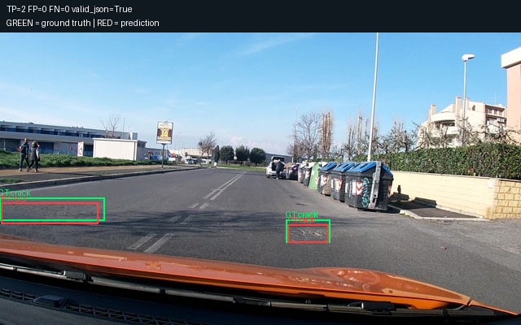
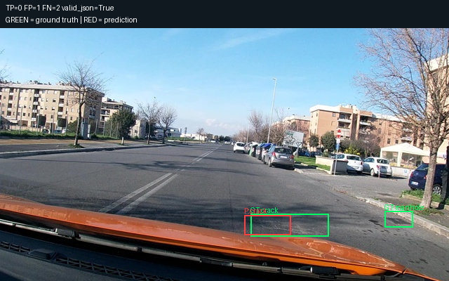
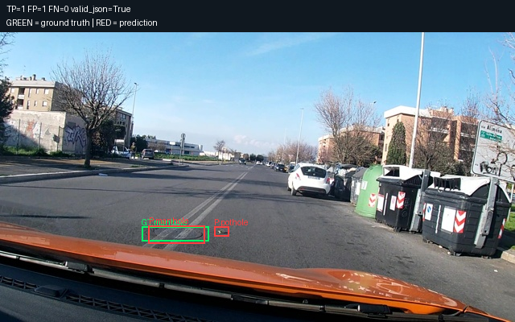
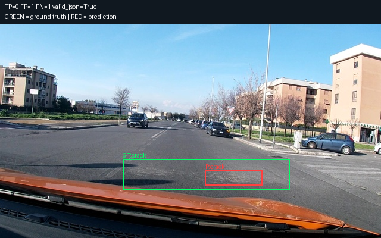

# Prediction examples

Green: ground truth. Red: predictions.

Examples are selected for illustration, not an estimate of accuracy.

## 1. vlcsnap-00200

TP=2 FP=0 FN=0 valid_json=True



Raw output:

```text
[{"label":"crack","bbox_2d":[359,653,531,758]},{"label":"manhole","bbox_2d":[898,778,998,836]}]
```

## 2. vlcsnap-00204

TP=1 FP=0 FN=0 valid_json=True



Raw output:

```text
[{"label":"manhole","bbox_2d":[252,622,341,667]}]
```

## 3. vlcsnap-00205

TP=2 FP=0 FN=0 valid_json=True



Raw output:

```text
[{"label":"crack","bbox_2d":[2,583,189,653]},{"label":"crack","bbox_2d":[553,656,631,717]}]
```

## 4. vlcsnap-00201

TP=0 FP=1 FN=2 valid_json=True



Raw output:

```text
[{"label":"crack","bbox_2d":[544,739,648,817]}]
```

## 5. vlcsnap-00202

TP=1 FP=1 FN=0 valid_json=True



Raw output:

```text
[{"label":"manhole","bbox_2d":[289,667,398,728]},{"label":"pothole","bbox_2d":[416,672,444,703]}]
```

## 6. vlcsnap-00203

TP=0 FP=1 FN=1 valid_json=True



Raw output:

```text
[{"label":"crack","bbox_2d":[539,683,689,753]}]
```
